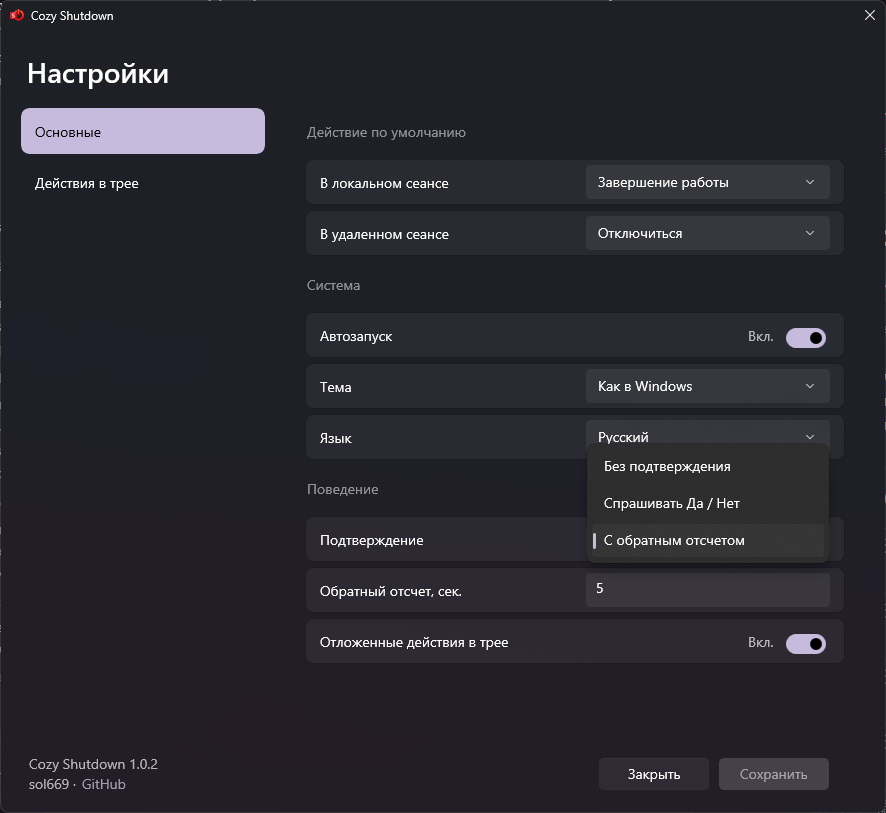
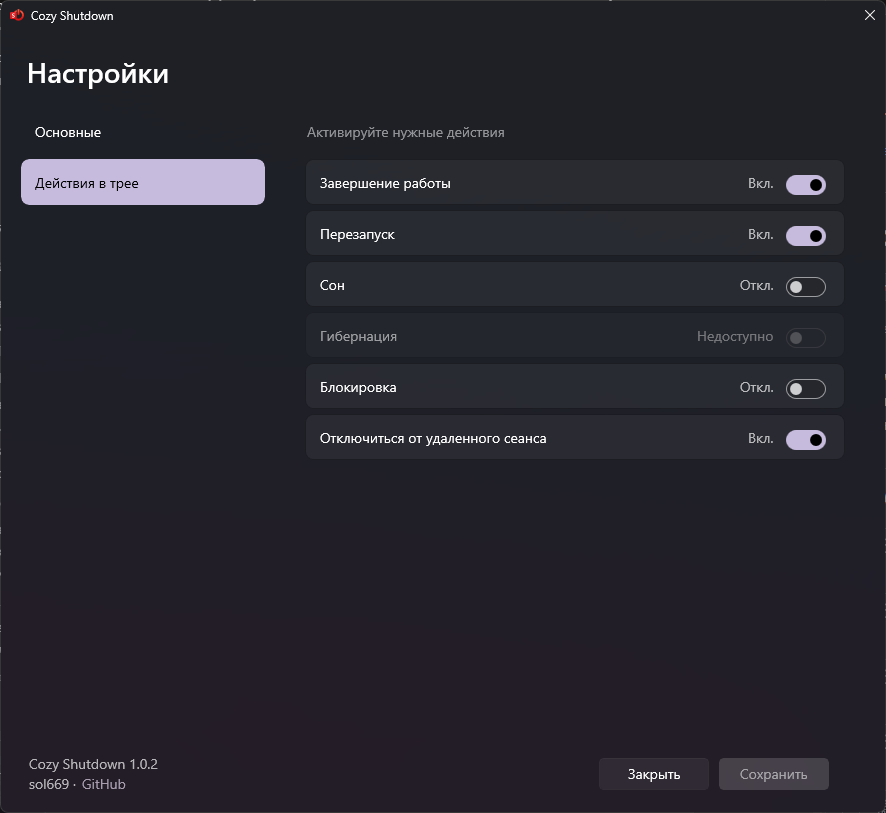

# Cozy Shutdown

[Русский](#русский) · [English](#english)

## Русский

**Cozy Shutdown** — компактная утилита для Windows, которая добавляет управление питанием в системный трей.

Можно настроить меню под себя, выбрать главное действие для обычного и удалённого сеанса, а также отложить выполнение команды.

### Возможности

- Выключение, перезагрузка, сон, гибернация и блокировка
- Отключение от RDP-сеанса
- Подключение к удалённому ПК из трея, пробуждение через Wake-on-LAN, выключение и перезапуск через Magic Packet Server
- Главное действие отдельно для локального и удалённого сеанса
- Подтверждение и обратный отсчёт перед действием
- Таймер: через интервал или к заданному времени
- Автозапуск, темы и русский/английский интерфейс

Поддерживаются Windows 10 и Windows 11 (x64).

### Скриншоты

### Скачать

| Вариант | Описание |
| --- | --- |
| Установщик | Загружает недостающие компоненты Microsoft |
| Автономный установщик | Все компоненты внутри, интернет не нужен |
| Portable | Без установки; нужны .NET 8 Runtime и Windows App Runtime 2.3 (x64) |
| Автономная Portable | Среды выполнения уже входят в комплект |

## English

**Cozy Shutdown** is a compact Windows utility for power controls in the system tray.

Configure the menu, choose a primary action for local and Remote Desktop sessions, and schedule commands when needed.

### Features

- Shut down, restart, sleep, hibernate, and lock
- Disconnect from an RDP session
- Connect to a remote PC from the tray, wake it via Wake-on-LAN, and shut it down or restart it via Magic Packet Server
- Separate primary actions for local and remote sessions
- Confirmation and countdown before an action
- Schedule by interval or a specific time
- Autostart, themes, and Russian/English interface

Supports Windows 10 and Windows 11 (x64).

### Download

| Edition | Description |
| --- | --- |
| Installer | Downloads missing Microsoft components |
| Offline installer | All components included; no internet required |
| Portable | Requires .NET 8 Runtime and Windows App Runtime 2.3 (x64) |
| Offline Portable | Includes the required runtimes |

## License

MIT · [sol669](https://github.com/sol669)
